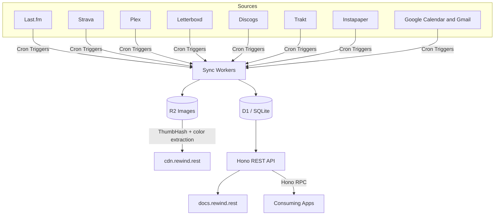

# Architecture

## Authentication

Data endpoints require a Bearer API key beginning with `rw_`. Scope is stored on the key record, not encoded in its prefix. `/v1/admin/` routes require admin scope; `/v1/health`, `/v1/health/sync`, and `/v1/openapi.json` are public. Webhooks use provider-specific verification. Keys are SHA-256 hashed and looked up in `api_keys`. Successful auth lookups are cached for 60 seconds per isolate. Rate limiting uses each key’s configured limit in a sliding 60-second window. See the [public authentication guide](../docs-mintlify/authentication.mdx).

## Sync and refresh

Cron definitions live in [`wrangler.toml`](../wrangler.toml) and dispatch through the scheduled handler in [`src/index.ts`](../src/index.ts). Cron times are UTC. Strava and Plex also accept verified webhooks. Each provider service owns its incremental sync and retry behavior; sync outcomes are recorded in `sync_runs`.

The [prepared Lately snapshot](projects/lately/README.md) refreshes independently of full provider sync. The [CD artwork Worker](projects/cd-artwork/PRODUCTION-RUNBOOK.md) has a separate configuration and workflow lifecycle.

### Post-Sync Pipeline

Every sync calls `afterSync()` which drives three things:

1. **Activity feed** -- inserts events into `activity_feed`, deduplicated by source_id + domain. Only new discoveries for listening (not every scrobble).
2. **Search index** -- upserts into FTS5 `search_index` for cross-domain full-text search.
3. **Revalidation hooks** -- fires POST to registered webhook URLs, filtered by domain, for ISR cache busting.

Each step is independent -- a failure in one doesn't block the others.

## Images

The [image pipeline](../src/services/images/pipeline.ts) resolves source candidates, stores originals in R2, and records placeholders and colors. Source ordering belongs to that implementation. [Image presets](../src/services/images/presets.ts) define URL construction, sizes, and cache headers; the [public Images guide](../docs-mintlify/domains/images.mdx) explains client usage.

Accepted disc artwork has a separate review and delivery lifecycle from square covers. See the [artwork runbook](projects/cd-artwork/PRODUCTION-RUNBOOK.md) and [WebP variant contract](projects/cd-artwork/WEBP-VARIANTS.md).

## Caching and request contracts

[`src/lib/cache.ts`](../src/lib/cache.ts) defines cache presets. Each route selects its own preset or supplies explicit headers, so read the handler for exceptions such as Lately. Do not infer cache behavior from a route name.

[`src/lib/date-filters.ts`](../src/lib/date-filters.ts) owns shared date-filter semantics. The generated [API reference](../docs-mintlify/openapi-spec.mdx) owns endpoint parameters and response schemas. Internal domain notes describe integration decisions, not a second copy of the public contract.

## Known Gotchas

- **D1 is SQLite** -- no PostGIS, no `generate_series`. Polylines are stored encoded, decoded client-side. Calendar/streak queries use recursive CTEs.
- **Strava token rotation** -- refresh token rotates on every exchange, must be persisted immediately.
- **Plex webhooks need Plex Pass** -- without it, falls back to cron-only polling.
- **No native image decoding in Workers** -- ThumbHash requires decoding via `jpeg-js`/`fast-png` (pure JS decoders) since `sharp`/`canvas` aren't available.
- **Last.fm artist images deprecated** -- removed from API in 2020, sourced from Apple Music/Fanart.tv instead.
- **FTS5 search_index has no user_id** -- multi-user filtering must join back to source entity tables.
